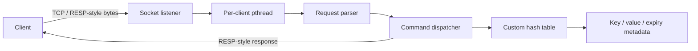

# Cedis

**Cedis** is an educational, Redis-inspired TCP key-value server written in C. It explores how a networked in-memory database works below the application level: socket programming, request parsing, hash tables, expiration metadata, and early replication mechanics.

The project grew out of the [CodeCrafters Redis challenge](https://codecrafters.io/challenges/redis). It is a learning implementation, **not a drop-in Redis replacement** or a production-ready database.

## At a glance

- **Language:** C
- **Networking:** POSIX TCP sockets; a POSIX thread is created for each accepted client
- **Protocol:** a limited, custom parser and serializer for Redis Serialization Protocol (RESP)-style requests and replies
- **Storage:** custom in-memory hash table with separate chaining, FNV-1a hashing, and resizing
- **Expiration:** `SET ... PX` metadata with lazy expiration checked during `GET`
- **Replication:** experimental handshake and command-forwarding code; incomplete and not suitable for reliable replication

## Implemented command paths

| Command | Current behavior | Important qualification |
| --- | --- | --- |
| `PING` | Replies `PONG` | Basic form only |
| `ECHO message` | Returns a bulk-string response | Parser changes argument text to lowercase |
| `SET key value` | Inserts a string entry and replies `OK` in master mode | Repeated keys are *not* replaced in place; the newest entry shadows older ones |
| `SET key value PX milliseconds` | Stores expiration metadata | Expiration math currently has integer-width issues |
| `GET key` | Retrieves a string value or returns a null bulk string | Checks expiration on access; behavior is not fully Redis-compatible |
| `INFO replication` | Generates basic role/replication metadata | Metadata generation needs memory-safety fixes |
| `REPLCONF`, `PSYNC` | Contains initial replica-handshake and synchronization responses | Prototype only; do not treat as working end-to-end replication |

These are the paths present in the source, not a claim of complete Redis command or RESP compliance. In particular, Redis lists, transactions, persistence, authentication, and clustering are **not implemented**.

## Build and run

### Requirements

- GCC and GNU Make
- POSIX socket and pthread support (for example, a Linux environment or WSL)
- Optional: `redis-cli` for trying simple commands

Build from the repository root:

```sh
make
```

The current Makefile produces an executable named `server.exe` even on Linux. Start it with the default port (`6379`):

```sh
./server.exe
```

Or choose a port:

```sh
./server.exe --port 6380
```

In another terminal, try the basic command paths:

```sh
redis-cli -p 6380 PING
redis-cli -p 6380 ECHO hello
redis-cli -p 6380 SET greeting world
redis-cli -p 6380 GET greeting
redis-cli -p 6380 SET short lived PX 2000
redis-cli -p 6380 GET short
```

**Note:** Keep test inputs small and simple. The current parser assumes a request fits in a single `recv()` call, has a 256-byte receive buffer, and normalizes *all* arguments to lowercase. It is not binary-safe or suitable for adversarial input. `PX` is implemented but its timing behavior is not yet reliable.

The repository also includes [`test_commands.txt`](test_commands.txt), containing example raw RESP requests sent using `nc`. These are manual examples, not an automated test suite.

## How it works



1. The server listens on a configurable TCP port and accepts connections.
2. Each accepted connection receives its own handler thread, while threads share a single dictionary instance.
3. A custom parser tokenizes the received request into command arguments.
4. The command dispatcher performs operations against the hash table and writes a protocol response.
5. `GET` checks expiration metadata and can delete an expired entry on access.

The store starts with **1,024 buckets**, uses **64-bit FNV-1a** to choose a bucket, resolves collisions with **separate chaining**, and doubles the bucket array when its entry count reaches the configured load-factor threshold. Insertion is currently append-by-prepending rather than true replacement for an existing key.

For code-level detail, see [Architecture](docs/architecture.md).

## Repository layout

```text
.
├── Makefile                 # Build server.exe
├── server.c                 # Sockets, threading, commands, replication experiments
├── test_commands.txt       # Manual wire-format examples
└── utils/
    ├── dict.c / dict.h     # Hash table and expiration fields
    ├── parser.c / parser.h # Request tokenization
    └── timing.c / timing.h # Wall-clock milliseconds helper
```

## Current status and limitations

Cedis is best understood as a **systems-programming prototype**. The architecture demonstrates useful concepts, but the current source contains outstanding correctness, concurrency, protocol-framing, memory-management, and replication issues. In particular:

- Shared dictionary operations are not synchronized across client threads.
- Duplicate `SET` operations create multiple entries for the same key.
- The parser does not handle fragmented or combined TCP requests correctly, and it lowercases values as well as command names.
- Some code paths have memory-safety and cleanup defects; disconnect handling is incomplete.
- The replication path contains incomplete initialization and protocol handling.

See [Known limitations and suggested fixes](docs/limitations.md) for specific, source-backed examples and a remediation order. The example commands above are illustrative, **not evidence of a fully verified or safe build**.

## Why this project

Cedis is a hands-on exploration of systems programming in C: designing a hash table rather than using a library, encoding and decoding network messages, managing allocation and ownership, and seeing how protocol semantics interact with concurrency and time. It also provides a concrete foundation for improving correctness through tests, safer parsing, and a clearer execution model.

## Documentation

- [Architecture and implementation notes](docs/architecture.md)
- [Known limitations and suggested improvements](docs/limitations.md)
- [Roadmap and issue-sized tasks](docs/roadmap.md)

## Acknowledgment

The initial project direction comes from the [CodeCrafters Redis challenge](https://codecrafters.io/challenges/redis). Redis is a separate project; Cedis is an independent educational implementation.