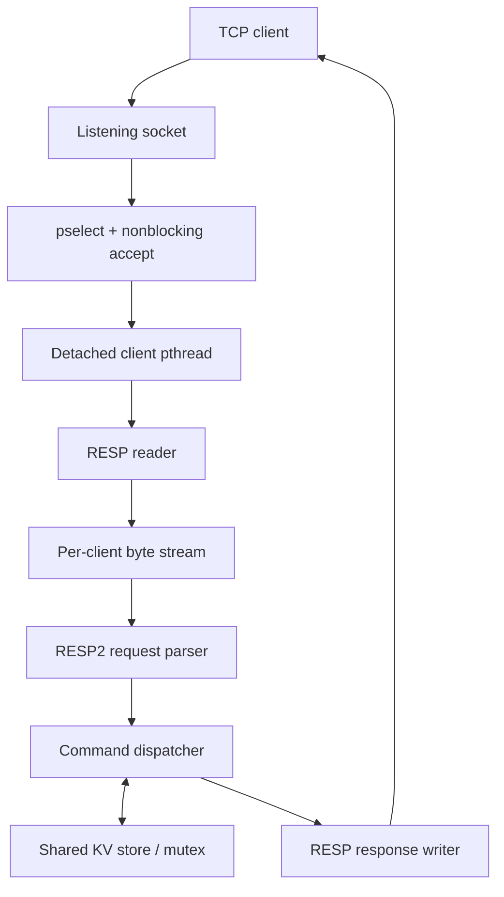

# Cedis architecture and implementation notes

> **Scope:** The stable core on [`cleanup/cv-ready`](https://github.com/Khemio/cedis/tree/cleanup/cv-ready), reviewed on 2026-11-20. Replication experiments are preserved separately on `codecrafters/replication-baseline`. This describes the implementation, not a production-readiness or security guarantee.

## 1. Overview

Cedis is a Redis-inspired, in-memory TCP key-value server implemented in C. It accepts RESP2-style requests, dispatches four commands, and stores binary-safe keys and values in a custom hash table. One POSIX worker thread serves each accepted client; all workers access a shared, mutex-protected `KV` instance.



The main thread manages listening, worker creation, and shutdown. It does **not** execute client commands. `server.c` currently contains startup, networking, dispatch, and connection-management functions; protocol and storage primitives are separate modules in `utils/`.

## 2. Server startup and client connections

1. `main()` defaults to port `6379`, or parses `--port` as an integer in the range `1`–`65535`. The stable build rejects `--replicaof`.
2. `kv_create()` initializes the shared store.
3. `createServer()` creates an IPv4 TCP socket, sets `SO_REUSEADDR`, binds to `INADDR_ANY`, calls `listen()`, and marks the listening descriptor `O_NONBLOCK`. Socket setup failures close the descriptor and return `-1` with an appropriate `errno`.
4. `main()` registers handlers for `SIGINT`/`SIGTERM`, blocks those signals outside its wait, and enters a `pselect()` loop.
5. When the listening descriptor is readable, `accept()` obtains a client socket. The server allocates a `threadArgs` object, registers it as active, and starts a **detached** pthread running `threadMain()`.

The listening socket is nonblocking, but accepted connections use blocking reads. On Linux, accepted sockets do not inherit the listener's `O_NONBLOCK` status in this implementation. The thread-per-connection architecture is deliberately simple, but there is no configured maximum number of simultaneous workers.

## 3. RESP request processing

These files separate network reads, byte buffering, and protocol parsing:

| Component | Responsibility |
| --- | --- |
| `utils/resp_stream.c` | Growable per-connection byte buffer; append and consume received bytes |
| `utils/resp.c` | Length-aware parsing of one complete request; allocation and cleanup of request arguments |
| `utils/resp_reader.c` | Repeatedly attempts parsing, reads more bytes via `recv()` when incomplete, and returns connection/read statuses |
| `server.c` | Dispatches parsed requests and sends RESP-formatted responses |

### Incremental framing

`resp_reader_next()` first asks `resp_parse_request()` whether its buffered bytes contain a complete request:

- **Complete:** the parser returns an owned `resp_request`, together with the number of consumed bytes. The reader removes those bytes while retaining any later pipelined requests.
- **Incomplete:** the reader calls `recv()` to append more data, then retries. This supports requests fragmented across TCP reads.
- **Invalid or out of memory:** it returns an error status, and the worker closes that connection.
- **EOF:** an empty buffer means a clean close (`RESP_READ_CLOSED`); remaining incomplete bytes mean a truncated request (`RESP_READ_TRUNCATED`).

The parser accepts **nonempty flat RESP arrays of bulk strings** (`*N` followed by `$length` arguments). It does not implement arbitrary nested arrays, inline commands, or full RESP2/RESP3 support. The current bounds are:

- Up to **1,024 arguments** per request (`MAX_ARGS`).
- Up to **1 MiB per bulk string** (`MAX_BULK_LEN`).
- Up to **2 MiB of buffered receive data** per connection (`RESP_STREAM_MAX_BYTES`).

All argument data is copied into byte arrays with explicit lengths; embedded NUL bytes do not terminate a key or value. Commands are compared case-insensitively without modifying other arguments. `resp_request_free()` releases request-owned argument buffers after command execution.

### Replies

`sendAll()` retries interrupted sends and handles partial writes using `send(..., MSG_NOSIGNAL)`; the latter avoids termination from `SIGPIPE` on a disconnected client. `sendBulk()` emits a RESP bulk-string header, the exact payload bytes, and the terminating CRLF. Other replies are short RESP simple strings, errors, or the null bulk string `$-1\r\n`.

## 4. Commands

`handleRespRequest()` currently supports:

| Request | Result |
| --- | --- |
| `PING` | `+PONG` |
| `ECHO message` | Bulk string containing the original message bytes |
| `SET key value` | Insert or replace; `+OK` on success |
| `SET key value PX milliseconds` | Insert or replace with a positive millisecond TTL |
| `GET key` | Bulk string for a present value; null bulk string if missing or expired |

Wrong argument counts, unsupported options, and invalid expiration values produce RESP errors. Unsupported commands return an explicit not-implemented error. `INFO`, `REPLCONF`, and `PSYNC` are **not** part of this stable build.

## 5. Storage engine: `utils/kv.c`

The store is opaque to callers through `KV` (`utils/kv.h`). Internally, it consists of a bucket array and singly linked lists of entries:

```text
KV
  buckets[0] -> entry -> entry -> NULL
  buckets[1] -> NULL
  ...
  bucket_count, count
  pthread_mutex_t

entry:
  key bytes + key length
  value bytes + value length
  has_expiry + expire_at_ms
  next pointer
```

- **Hashing:** 64-bit FNV-1a over all key bytes, then modulo the current number of buckets.
- **Initial capacity:** 16 buckets.
- **Collision resolution:** separate chaining.
- **Growth:** the bucket array doubles when the entry count reaches approximately 75% of the bucket count before inserting another entry. Resize **relinks existing entries** rather than duplicating their contents.
- **Replacement:** setting an existing key replaces the value and its expiry metadata without creating another entry. An ordinary `SET` clears any previous expiry.
- **Deletion:** an internal removal helper unlinks and frees an entry and decrements the count. A `kv_remove()` API exists, although no client-facing `DEL` command is implemented.

### Ownership and synchronization

The store copies keys and values into owned allocations. Each public KV operation that accesses or mutates the table acquires the store's mutex; resizing happens while holding that mutex. This is a **single lock for the whole store**, not per-bucket locking.

`kv_get()` returns a newly allocated `kv_blob` containing a **copy** of the value. Callers must release it with `kv_blob_free()`. This prevents a worker from retaining a pointer into storage that another thread could replace, and lets the worker send the reply **after releasing the storage lock**.

`kv_destroy()` is only safe after no worker can access the store. The server arranges that ordering during shutdown.

## 6. Expiration

For `SET key value PX duration`, the dispatcher obtains milliseconds from `CLOCK_MONOTONIC` using checked 64-bit arithmetic. The KV layer stores `expire_at_ms = now_ms + duration` and rejects zero or overflowing TTLs.

`GET` supplies the current monotonic timestamp. If `now_ms >= expire_at_ms`, the key is deleted and reported as absent. This is **lazy expiration**: there is no timer thread or background eviction process. Consequently, expired entries can continue consuming memory until accessed or replaced.

## 7. Thread lifetime and graceful shutdown

Each worker owns its accepted socket descriptor, its `threadArgs` allocation, and its per-client RESP reader. All workers share `KV *kv`.

Normal worker exit follows this path:

```text
resp_reader_next()
  -> clean EOF, malformed/truncated request, read failure,
     or failed response send
  -> break request loop
  -> resp_reader_free()
  -> releaseClient() [unregister + close socket + free args]
  -> return from threadMain()
```

`active_clients` is a linked list protected by `clients_mutex`. A client is registered **before** its worker thread is created; if thread creation fails, the main thread unregisters and closes it.

### Shutdown sequence

1. A `SIGINT` or `SIGTERM` handler sets a `volatile sig_atomic_t` shutdown flag. It does not call locking or cleanup functions from signal context.
2. The main thread normally blocks these signals, temporarily unblocking them **atomically during `pselect()`**. Worker threads inherit the blocked signal mask.
3. After shutdown is requested, the listening loop ends and the main thread closes the listener.
4. `drainClients()` locks the client registry, calls `shutdown(fd, SHUT_RDWR)` on each active socket, then waits on `clients_empty` until the registry is empty.
5. A blocked worker's socket read can finish because of shutdown. Each worker runs its cleanup and `releaseClient()`. The last unregistering worker signals the condition variable.
6. Once workers have unregistered and no longer use the shared store, the main thread destroys `KV` and exits.

`pthread_cond_wait()` atomically releases the registry mutex while waiting, allowing workers to unregister; it reacquires that mutex before returning. Socket **shutdown** is used to wake I/O, while socket **close** remains coordinated with worker release to avoid file-descriptor-reuse races.

This design coordinates shutdown rather than forcibly canceling worker threads. It has been exercised with idle clients and process signals, but is not a formal proof of race freedom.

## 8. Tests and verification

The build and tests are in the root `Makefile` and `tests/`.

```sh
make
make test
```

`make test` runs four unit-test executables (RESP parser, RESP reader,
KV storage, and multithreaded KV access), the Python process-lifecycle
tests, and all four TCP integration suites.

The lifecycle tests cover `SIGINT`, `SIGTERM`, an idle client, and a
second process failing to bind an occupied port. The TCP integration
suites exercise pipelining, fragmentation, binary payloads, TTL,
concurrent clients, 1,000 client connections, malformed frames,
and recovery after invalid requests.

The TCP integration runner (`tests/run_integration.py`) starts a
separate Cedis subprocess on a temporary port, passes its port to the
test scripts through `CEDIS_TEST_PORT`, and terminates the subprocess
after the tests complete. No manually started server is required.
Run only those suites with:

```sh
make test-integration
```

For manual execution, the TCP test scripts still default to port
`6381` when `CEDIS_TEST_PORT` is not set.

The complete unit, lifecycle, and TCP integration suites have passed
with AddressSanitizer and UndefinedBehaviorSanitizer in the development
environment. These tests do not establish production security or
the absence of every race.

## 9. Current boundaries and future work

Cedis deliberately remains a narrow educational server:

- In-memory only: no persistence or recovery after restart.
- A subset of RESP2 requests and only four command names; not Redis-compatible in general.
- No authentication, TLS, or isolation between users. The listener binds to all IPv4 interfaces; **do not expose the server to untrusted networks**.
- Unbounded thread-per-client design, no configured connection or memory budget, and a single global storage mutex.
- The listening loop uses `fd_set`/`pselect()` and rejects a listening descriptor outside the `FD_SETSIZE` range.
- Further fault-injection coverage for uncommon initialization failures, resource exhaustion, and adversarial clients remains worthwhile.
- Replication experiments are isolated on `codecrafters/replication-baseline`; the stable build rejects `--replicaof`.

See [known limitations](limitations.md) for actionable follow-up work and [roadmap](roadmap.md) for project priorities.

## 10. Source map

| Path | Responsibility |
| --- | --- |
| `server.c` | CLI, socket setup, `pselect()`/accept loop, worker lifecycle, command dispatch, reply writing |
| `utils/resp.h`, `utils/resp.c` | Request representation, bounded RESP parsing, request ownership |
| `utils/resp_stream.h`, `utils/resp_stream.c` | Growable per-client receive buffer |
| `utils/resp_reader.h`, `utils/resp_reader.c` | Blocking socket reader; request framing and connection statuses |
| `utils/kv.h`, `utils/kv.c` | Binary-safe, mutex-protected in-memory hash table and TTL |
| `tests/` | Unit, protocol, concurrency, error-handling, and process lifecycle tests |
| `Makefile` | Development and compatibility binaries, unit and lifecycle test targets |
