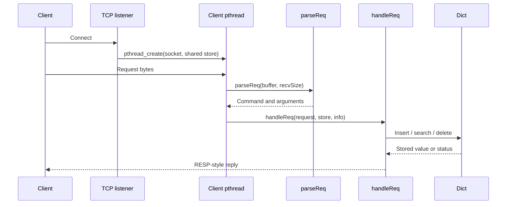

# Cedis architecture and implementation notes

> **Source reference:** [`Khemio/cedis`](https://github.com/Khemio/cedis), `main` branch inspected on 2026-11-13. This document describes the implementation *as written*, including unfinished functionality.

## 1. Overall design

Cedis is a TCP server with an in-memory string-to-string dictionary. `server.c` holds connection handling, a command dispatcher, and experimental replication-related code. `utils/` contains the dictionary, request parser, and a wall-clock time helper.



The listener accepts clients in an indefinite loop. A new pthread runs `threadMain` for each connection. All worker threads receive the same `Dict` pointer and replication metadata pointer; there is no mutex around shared state.

**Important:** The worker loop currently continues when `recv()` returns zero or an error. Normal connection teardown and allocation cleanup are not properly completed.

## 2. Storage engine: `utils/dict.c`

### Layout

The dictionary owns an array of bucket pointers. Each bucket is the head of a linked list of entries:

```text
Dict
 ├─ size: bucket count (initially 1024)
 ├─ n: number of inserted entries
 └─ table: array of linked-list heads
        ├─ bucket 0 -> entry -> entry -> NULL
        ├─ bucket 1 -> NULL
        └─ ...

entry = { key, value, expiry, expire_at, next }
```

- **Hash function:** 64-bit FNV-1a over null-terminated key bytes.
- **Bucket selection:** `hash_function(key) % d->size`.
- **Collision resolution:** separate chaining with singly linked lists.
- **Insertion:** allocates an entry, duplicates the key/value strings, and prepends the entry to its bucket.
- **Lookup:** walks the selected chain and returns the first matching key (the most recently inserted match).
- **Deletion:** unlinks the first matching entry.
- **Growth:** when `n >= size * MAX_LOAD_FACTOR` (threshold configured as `1`), the table doubles and reinserts existing records. This allocates new entry copies instead of moving existing nodes.

These choices aim for expected constant-time lookup and insertion *under a reasonable key distribution*, but the project has no published performance measurements or performance guarantees.

### Duplicate-key semantics

`DictInsert` does not detect an existing key. A second `SET` creates another entry that shadows the first. If the newest entry expires and is deleted, an older value can become visible again. This differs from Redis `SET`, which replaces the value associated with a key.

The dictionary's `n` counts inserted entries rather than distinct keys, and `DictDelete` currently does not decrement `n`.

## 3. Time-to-live (TTL)

`SET key value PX milliseconds` extracts the millisecond duration and stores an expiry marker. `GET` calls the time helper, checks the marker, and lazily deletes an entry judged expired.

`utils/timing.c` uses `clock_gettime(CLOCK_REALTIME, ...)` and converts the timestamp to milliseconds. This is **wall-clock** time, not a monotonic clock. There is no dedicated expiration queue or background eviction worker in this revision.

**Correctness issue:** `time_mili()` returns `long`, but `server.c` assigns that value to `int now`; storing an epoch timestamp in an `int` can overflow or truncate it. Expiration should be considered a proof of concept until integer widths and timing semantics are fixed.

## 4. Request parsing and responses

`utils/parser.c` implements `parseReq`, which splits a received message around carriage returns, reads an array count, and creates an array of argument structures (`len` and `val`). The dispatcher in `server.c` compares the command argument against literal command names and sends formatted responses with `send()`.

Current assumptions and limits:

- A full request is assumed to arrive in one `recv()` call; TCP does not preserve request boundaries.
- The receive buffer is 256 bytes with no robust accumulation or framing.
- The RESP array count is extracted from a single character, so counts of 10 or more are not handled correctly.
- Payloads are processed as null-terminated strings; embedded NUL bytes and arbitrary binary strings are not supported.
- Every argument is converted to lowercase. Redis command names are case-insensitive, but **keys and values should not be changed**.
- The implementation handles only a narrow subset of RESP-style arrays and replies, without comprehensive validation of length fields, partial frames, or malformed input.

These constraints are particularly relevant because the code works with byte streams, but its parsing strategy resembles parsing complete text records.

## 5. Commands

`handleReq` in `server.c` contains explicit branches for the following:

| Command path | Execution |
| --- | --- |
| `PING` | Writes a simple `+PONG` response |
| `ECHO` | Formats the next argument as a bulk string |
| `SET` | Duplicates argument strings and calls `DictInsert`; replies `+OK` in master mode |
| `GET` | Calls `DictSearch`, checks expiration metadata, and formats a value or null bulk-string reply |
| `INFO replication` | Attempts to format role, replication ID, and offset information |
| `REPLCONF` | Replies to known handshake arguments and tracks replica client sockets |
| `PSYNC` | Sends a full-resynchronization line and a fixed empty RDB-like payload |

The latter three paths belong to the unfinished replication experiment. They should not be advertised as a complete, reliable feature.

## 6. Replication experiment

The source has two role initializers:

- **Master metadata:** role, a fixed replication ID, replication offset `0`, and a list of connected replica file descriptors.
- **Replica metadata:** role `slave`.

The master attempts to answer `REPLCONF` and `PSYNC`, then forward serialized `SET` commands to tracked replica sockets. The replica-side code contains a `PING` → `REPLCONF` → `PSYNC` handshake sequence.

However, the replica startup path references the listening socket before its initialization, response parsing is incomplete, and the `listenToMaster` function is empty. Replication offsets, continuous state synchronization, reconnect logic, and robust snapshot transfer are not implemented. The forwarding path does not fully preserve command options such as expiration.

These are implementation experiments, **not working replication guarantees**.

## 7. Source files and responsibilities

| File | Responsibility |
| --- | --- |
| [`server.c`](https://github.com/Khemio/cedis/blob/main/server.c) | TCP listener, client threads, command handling, initial replication code |
| [`utils/dict.c`](https://github.com/Khemio/cedis/blob/main/utils/dict.c) | Dictionary creation, FNV-1a hashing, insert/search/delete, growth |
| [`utils/parser.c`](https://github.com/Khemio/cedis/blob/main/utils/parser.c) | Basic RESP-style request tokenization |
| [`utils/timing.c`](https://github.com/Khemio/cedis/blob/main/utils/timing.c) | Milliseconds based on `CLOCK_REALTIME` |
| [`Makefile`](https://github.com/Khemio/cedis/blob/main/Makefile) | GCC build with pthread linking |
| [`test_commands.txt`](https://github.com/Khemio/cedis/blob/main/test_commands.txt) | Raw protocol examples for manual testing |

## 8. Suggested next architecture milestones

1. Replace the token-based parser with a length-aware, incremental RESP decoder and connection input buffer.
2. Define ownership rules for requests and stored values; eliminate leaks and out-of-bounds operations.
3. Make dictionary semantics correct: unique keys, replacement behavior, accurate size tracking, and safe deletion.
4. Replace inconsistent time widths with `int64_t` milliseconds and specify TTL semantics clearly.
5. Choose a deliberate concurrency strategy (mutex-protected shared store or event-loop architecture) and test it.
6. Add automated unit and integration tests before extending replication.
7. Revisit replication only after command execution and protocol framing are trustworthy.

See [Known limitations](limitations.md) for concrete issues and priorities.